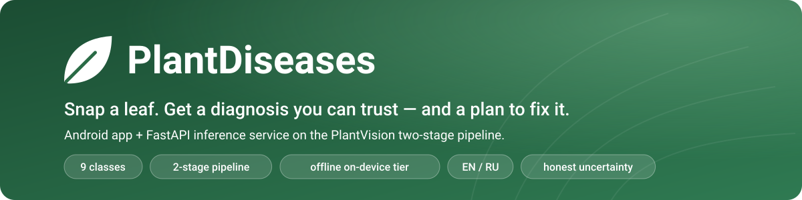
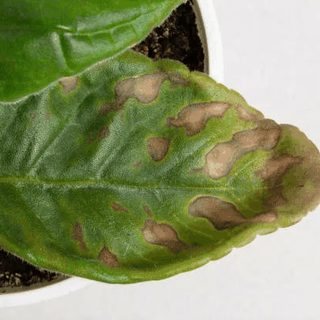
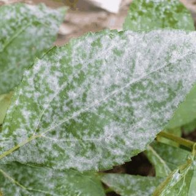
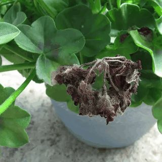
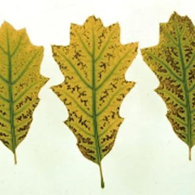
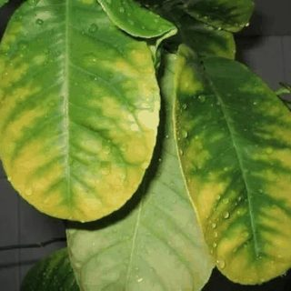
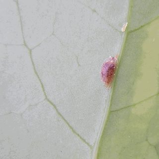
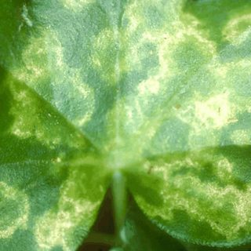
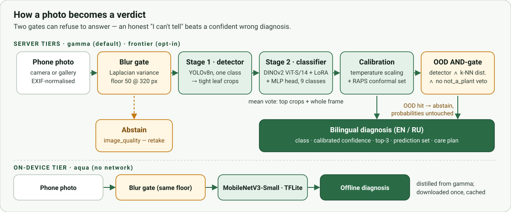
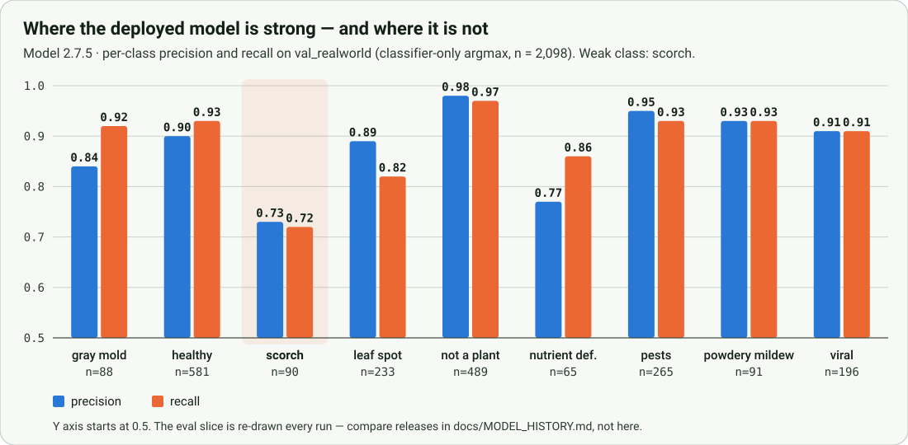

<div align="center">



<br>

[](https://github.com/pmixay/plantdiseases/actions/workflows/ci.yml)


[](https://unlicense.org)

[What it does](#what-it-does) · [Classes](#what-it-recognises) · [How it works](#how-it-works) · [Status](#project-status) · [Quick start](#quick-start) · [API](#api) · [Docs](#documentation)

</div>

---

## What it does

Point the phone at a houseplant leaf. A two-stage model finds the leaf, classifies
it, says how sure it is — or says it can't tell — and the app turns the verdict into
a care plan you can follow.

| | |
|---|---|
| 📷 **Diagnose from a photo** | 9-class verdict with calibrated confidence, top-3 alternatives and a conformal prediction set. A blur gate and an out-of-distribution gate refuse shots the model shouldn't judge. |
| 📴 **Works offline** | Pick the on-device **Aqua** model on the scan screen: a MobileNetV3-Small TFLite file, downloaded once from your server and cached. No network at scan time. |
| 🩺 **No photo? Describe it** | Symptom triage diagnoses from a checklist when the camera or the ML pipeline can't be used. |
| 🌍 **Bilingual care plans** | Every diagnosis ships in English and Russian: description, treatment checklist, prevention, watering / feeding / humidity schedule, red flags. |
| 🪴 **Personal garden** | Plants grouped into rooms, scan history per plant, a month-grid care calendar, treatment plans, watering and feeding reminders, a lunar calendar, side-by-side photo comparison and a health trend. |
| 🤖 **AI plant doctor** | Opt-in chat scoped to your scan's diagnosis (OpenRouter). |
| 🔎 **Species ID** | PlantNet identification fills in what the plant *is*, because that changes what you'd call the problem. |
| 👥 **Community** | Opt-in shared scans on a map and nearby feed, plus second opinions from other growers. Anonymous: no account, no login. |

Every optional integration (PlantNet, OpenRouter, FCM push) degrades to a clear
"not configured" state instead of failing.

---

## What it recognises

Nine classes — eight plant states and a real `not_a_plant` rejection head. `leaf_spot`
merges bacterial and fungal spots and `pests` merges mealybugs and scale: in each case
the two can't be reliably told apart from a phone photo. Photos are the in-app guide
examples.

<table>
<tr>
<td align="center" width="33%"><br><b>Healthy</b><br>Здоровое растение</td>
<td align="center" width="33%"><br><b>Leaf spot</b><br>Пятнистость листьев</td>
<td align="center" width="33%"><br><b>Powdery mildew</b><br>Мучнистая роса</td>
</tr>
<tr>
<td align="center"><br><b>Gray mold (Botrytis)</b><br>Серая гниль</td>
<td align="center"><br><b>Leaf scorch (under-watering)</b><br>Краевой ожог</td>
<td align="center"><br><b>Nutrient deficiency</b><br>Дефицит питания</td>
</tr>
<tr>
<td align="center"><br><b>Sap-sucking pests</b><br>Сосущие вредители</td>
<td align="center"><br><b>Viral disease</b><br>Вирусное заболевание</td>
<td align="center" valign="middle">🚫🌿<br><b>Not a plant</b><br>Не растение<br><br>a trained rejection class, so a shoe or a screenshot is refused rather than diagnosed</td>
</tr>
</table>

The API also accepts **out-of-head** feedback labels the classifier does not predict
(`edema`, `sunburn_or_scorch`, `other`, and `is_a_plant` — the one-tap "the reject was
wrong" correction). They are stored with `out_of_head=1` and feed the retraining loop.
The canonical class list is `DEFAULT_CLASS_NAMES` in [`server/classifier.py`](server/classifier.py);
at runtime the manifest-bound `classes.json` is the source of truth.

---

## How it works



- **Two stages, because a room is not a leaf.** YOLOv8n finds the leaf first, so the
  classifier (frozen DINOv2 ViT-S/14 + LoRA + MLP head) sees a tight crop. Votes from the
  top crops and the whole frame are averaged.
- **Two gates that can say "I can't tell".** The *blur gate* stops an unfocused shot
  before any model runs (`image_quality` abstention). The *OOD AND-gate* abstains only
  when the detector, an embedding-space k-NN distance, **and** the absence of a
  `not_a_plant` veto all agree.
- **Calibrated, never rewritten.** Temperature scaling plus RAPS conformal sets;
  post-processing never swaps the argmax for a lower-probability disease, it only adds
  soft warnings (`uncertain_healthy`, `disease_suspected:*`, `low_confidence`).
- **Fail-closed artefacts.** The server refuses to boot unless one complete,
  notebook-produced bundle verifies byte-for-byte (size + SHA-256) against its manifest.
  No demo fallback, no auto-download.

### Model tiers

| Tier | Backbone | Where it runs |
|---|---|---|
| `aqua` | MobileNetV3-Small distilled from `gamma` → TFLite float32 | **On the phone, offline.** Blur gate and `not_a_plant` head; no calibrated OOD overlay. |
| **`gamma`** | frozen DINOv2 ViT-S/14 + LoRA + MLP head → ONNX | **Server default.** Full pipeline above. |
| `frontier` | frozen DINOv2 ViT-B/14 + LoRA + MLP head | Server, off by default (`FRONTIER_ENABLED`, wants a GPU). The app shows it as unavailable until enabled. |

An unknown family falls back to the default; an unavailable one answers `available:false`
rather than erroring. Training happens only in the Colab notebook
[`server/train_notebook.ipynb`](server/train_notebook.ipynb) — the server and the app only
load, verify and run models. Pipeline contract: [`MODEL_CARD.md`](server/models/MODEL_CARD.md).

---

## Project status

**Deployed:** model **2.7.5** (first manifest-bound bundle) · app **1.9** · 39 API routes.
Per-run numbers live in [`docs/MODEL_HISTORY.md`](docs/MODEL_HISTORY.md); the roadmap
below is a summary of [`docs/ROADMAP.md`](docs/ROADMAP.md).



Scorch is the model's weak spot: it is the class most often read as `healthy`. Closing
that gap is a data problem first, so that is what the roadmap's critical path targets.

| | Work left |
|---|---|
| 🔴 **Critical path** | Collect **v9 data** — 400 early-stage scorch families with boxes · carve the locked test set **T_v1** from 80 export rows · build **OOD benchmark v3** |
| 🟠 **Model checks** | 2.7.5 is **not** significantly better than 2.7.2 on the shared holdout (paired bootstrap, 2026-10-27) · ablate the augmentation profile |
| 🟡 **Hardening** | Likes and views still accept a key-less pseudo-id · Aqua has no classifier-side OOD signal |
| 🔵 **Refactors** | Split `main.py` (~6k lines) into routers · split `ScanRepository` · retire Gson · type-check the server |

Full list, rationale and the "settled — do not retry" table: [`docs/ROADMAP.md`](docs/ROADMAP.md).

---

## Quick start

### Server

```bash
cd server
./start.sh            # Windows: start.bat
```

Creates a virtualenv, installs the inference requirements and serves FastAPI on
`0.0.0.0:8000` (`--port N` or `PORT` to change; `start.bat` takes `--port` only).

Model weights are **not committed**. Extract one complete notebook-produced archive into a
fresh `server/models/` and preflight it without loading any graph:

```bash
python tools/verify_bundle.py models/
```

The full contract is [`DEPLOYMENT.md`](DEPLOYMENT.md) §2. Tests need no weights:
`pip install -r requirements-dev.txt && pytest tests -q`.

### Android

Open `android/` in current Android Studio (AGP 9.1, Gradle 9.5, JDK 17, `minSdk` 31).
The server URL is baked in at build time:

```bash
./gradlew :app:assembleDebug -PAPI_BASE_URL=http://192.168.1.42:8000/
```

Release signing, FCM push, TLS and the optional keys (`PLANTNET_API_KEY` for species ID,
`OPENROUTER_API_KEY` for the AI doctor) are in [`DEPLOYMENT.md`](DEPLOYMENT.md).

---

## API

All routes live under `/api`; [`server/openapi.json`](server/openapi.json) is the complete,
authoritative list.

<details>
<summary><b>Route overview</b> (click to expand)</summary>

**Core**

| Method | Path | Description |
|---|---|---|
| `GET` | `/api/health` | Liveness, uptime, class count |
| `GET` | `/api/capabilities` | Per-family availability (aqua / gamma / frontier), server version, bilingual class metadata |
| `GET` | `/api/metrics` · `/api/metrics/prometheus` | JSON counters (incl. per-class feedback accuracy) · Prometheus exposition |
| `POST` | `/api/telemetry/errors` | Anonymous client error reports |

**Diagnosis**

| Method | Path | Description |
|---|---|---|
| `POST` | `/api/analyze` | Photo → bilingual diagnosis (`?family=aqua\|gamma\|frontier`, default `gamma`) |
| `POST` | `/api/symptom-diagnose` | No-photo symptom triage |
| `POST` | `/api/identify` | PlantNet species identification |
| `POST` | `/api/chat` | AI plant doctor |
| `POST` | `/api/care-plan` · `/api/progression` | Care schedule + treatment checklist · trend across scans |
| `POST` | `/api/feedback` · `/api/feedback/image` | "Was this right?" — append-only training signal |

**Content & media**

| Method | Path | Description |
|---|---|---|
| `GET` | `/api/guide/photo/{key}` | Disease and pest example photos |
| `GET` | `/api/aqua/manifest` · `/api/aqua/model` | On-device model manifest + bytes |
| `GET` | `/api/species-info` · `/api/species-diseases` · `/api/species-profile` | Localized species summary · common conditions · flowering + range |
| `GET` | `/api/popular` | Region-aware popular-plants bundle |
| `GET` | `/api/plant-photo` | SSRF-guarded Wikimedia image proxy |

**Community** (opt-in, anonymized, coarse-rounded coordinates)

| Method | Path | Description |
|---|---|---|
| `POST` | `/api/community/scan` | Share a scan |
| `GET` | `/api/community/nearby` · `/map` · `/heatmap` · `/by-species` | Feed, map markers, k-anonymized density grid, per-species scans |
| `POST` | `/api/community/opinion` · `/request-opinion` · `/request-opinion/cancel` | Cast, request or cancel a second opinion |
| `GET` | `/api/community/opinions/{scan_id}` · `/my-scan-opinions[/{user_pseudo_id}]` | Opinions + consensus; replies to your scans |
| `POST` | `/api/community/like` · `/view` | Like or unlike; record views |
| `POST` | `/api/community/safety/report` · `/safety/block` | Report or block |
| `POST` | `/api/community/authors/adopt` | Bind the anonymous author handle |
| `GET` | `/api/community/thumb/{filename}` | Scan thumbnail |
| `POST` | `/api/push/register` | Register an FCM token (no-op without credentials) |

</details>

---

## Project layout

```
plantdiseases/
├── android/           Kotlin app — Material 3, CameraX, Room, Ktor, Hilt; XML views, no Compose
├── server/            FastAPI + the recognition pipeline
│   ├── main.py            HTTP layer, middleware, validation
│   ├── pipeline.py        two-stage pipeline + blur/OOD gates
│   ├── bundle.py          fail-closed artefact verification
│   ├── detector.py · classifier.py · ood.py · conformal.py
│   ├── ai_services.py     PlantNet, OpenRouter, care plans
│   ├── community.py · feedback.py · labeling*.py   the data loop
│   ├── tools/             bundle verifier, paired eval, feedback analysis
│   ├── train_notebook.ipynb   the whole training recipe (Colab only)
│   └── models/            MODEL_CARD.md — weights are provisioned out of band
├── docs/              ROADMAP · MODEL_HISTORY · DATASET_LABELING_PLAN · assets/
├── site/              one-page project site (static HTML)
├── .github/workflows/ ci.yml — push-only: ruff + pytest · ktlint + detekt + tests + release build
└── DEPLOYMENT.md · CLAUDE.md
```

---

## Documentation

| Doc | What's in it |
|---|---|
| [`DEPLOYMENT.md`](DEPLOYMENT.md) | Model bundle, production config, nginx + TLS, systemd, monitoring, Android signing and FCM |
| [`docs/ROADMAP.md`](docs/ROADMAP.md) | Live status and open work |
| [`docs/MODEL_HISTORY.md`](docs/MODEL_HISTORY.md) | Every archived training run with its metrics, and how to compare releases fairly |
| [`server/models/MODEL_CARD.md`](server/models/MODEL_CARD.md) | Version-agnostic pipeline, calibration and limitations contract |
| [`docs/DATASET_LABELING_PLAN.md`](docs/DATASET_LABELING_PLAN.md) | The data-collection and judging loop |
| [`server/train_notebook.ipynb`](server/train_notebook.ipynb) | Training, calibration, ONNX/TFLite export |

---

## License

[Unlicense](https://unlicense.org) — public domain, free for any use.

The Unlicense covers first-party code. Third-party model weights (DINOv2 — Apache-2.0;
Ultralytics YOLOv8 — AGPL-3.0, used at training/export time only), datasets
(PlantVillage, PlantDoc, iNaturalist, COCO, Open Images), and runtime libraries
(including osmdroid and the RuStore update/review SDKs in the Android app) remain under
their own licenses.
