# Account Beta Private Schema

The authoritative definitions are Alembic migrations `0001` through `0010`
plus `account-server/app/db/models.py`. This diagram is a handoff view, not a
second schema source. The reviewed Alembic head is `0010_billing_lifecycle_quota_policy`.
At that head PostgreSQL contains 24 application tables plus the
Alembic-owned `alembic_version` table. Restore and privilege-convergence checks
must compare the exact inventory; finding only the older 0006/13-table shape is
a failed migration, not a compatible runtime state.

```mermaid
erDiagram
    accounts ||--o{ account_identities : owns
    accounts ||--o| password_credentials : authenticates
    accounts ||--o{ sessions : opens
    sessions ||--o{ refresh_tokens : rotates
    refresh_tokens o|--o| refresh_tokens : replaces
    pending_signups ||--o| signup_completions : starts
    pending_signups ||--o| pending_password_credentials : stages
    accounts o|--o{ signup_completions : provisions
    sessions o|--o{ signup_completions : provisions
    accounts ||--o{ reauth_challenges : authorizes
    sessions ||--o{ reauth_challenges : scopes
    accounts ||--o| account_deletion_jobs : queues
    accounts ||--o| account_nickname_jobs : propagates
    accounts ||--o{ account_nickname_claims : reserves
    accounts ||--o{ push_devices : owns
    sessions ||--o{ push_devices : registers
    accounts ||--o{ account_consents : records
    accounts ||--o{ account_security_events : emits
    sessions ||--o{ account_security_events : contextualizes
    accounts ||--o| billing_customers : receives
    billing_customers ||--o{ subscriptions : validates
    billing_purchase_fetches ||--o| subscriptions : orders
    accounts ||--o{ feature_usage : meters
    accounts ||--o{ feature_usage_receipts : deduplicates
    vendor_budget_authorities ||--o{ vendor_budget_daily : serializes
    vendor_budget_authorities ||--o{ vendor_budget_receipts : authorizes

    accounts {
        uuid id PK
        uuid community_actor_id UK
        string nickname
        string normalized_nickname UK
        enum primary_provider
        string private_provider_display_name
        string private_provider_avatar_url
        int authorization_version
        enum state
    }
    account_identities {
        uuid id PK
        uuid account_id FK
        enum provider
        string provider_subject
        string private_display_name
        string private_avatar_url
        timestamp refreshed_at
    }
    password_credentials {
        uuid id PK
        uuid account_id FK,UK
        bytes keyed_email_fingerprint UK
        string argon2id_password_hash
        timestamp password_changed_at
    }
    sessions {
        uuid id PK
        uuid account_id FK
        uuid installation_id
        string generic_device_label
        uuid token_family_id UK
        timestamp idle_expires_at
        timestamp absolute_expires_at
        timestamp revoked_at
    }
    refresh_tokens {
        uuid id PK
        uuid session_id FK
        bytes sha256_token_hash UK
        timestamp consumed_at
        uuid replacement_token_id FK
    }
    pending_signups {
        uuid id PK
        bytes sha256_token_hash UK
        enum provider
        string provider_subject
        string private_display_name
        string private_avatar_url
        uuid installation_id
        timestamp expires_at
        timestamp consumed_or_cancelled_at
    }
    pending_password_credentials {
        uuid id PK
        uuid pending_signup_id FK,UK
        bytes keyed_email_fingerprint
        string argon2id_password_hash
    }
    signup_completions {
        uuid id PK
        uuid pending_signup_id FK,UK
        uuid installation_id
        bytes sha256_request_fingerprint
        uuid account_id FK
        uuid session_id FK
        timestamp expires_at
        timestamp confirmed_at
        timestamp cancelled_at
    }
    reauth_challenges {
        uuid id PK
        uuid account_id FK
        uuid session_id FK
        bytes sha256_token_hash UK
        enum provider
        enum scope
        timestamp expires_at
        timestamp consumed_at
    }
    account_deletion_jobs {
        uuid id PK
        uuid account_id FK
        uuid community_actor_id
        enum state
        int attempt_count
        string allowlisted_error_code
        timestamp next_attempt_at
    }
    account_nickname_jobs {
        uuid id PK
        uuid account_id FK,UK
        uuid community_actor_id
        string nickname
        enum state
        int attempt_count
        string allowlisted_error_code
        timestamp next_attempt_at
    }
    account_nickname_claims {
        uuid id PK
        uuid account_id FK
        string normalized_nickname UK
        enum state
        timestamp updated_at
    }
    push_devices {
        uuid id PK
        uuid account_id FK
        uuid session_id FK
        bytes aes_gcm_ciphertext
        bytes keyed_fingerprint UK
        enum platform
        timestamp disabled_at
    }
    account_consents {
        uuid id PK
        uuid account_id FK
        enum consent_type
        string disclosure_version
        bool granted
    }
    account_security_events {
        uuid id PK
        uuid account_id FK
        uuid session_id FK
        enum event_type
        enum outcome
        timestamp expires_at
    }
    billing_customers {
        uuid id PK
        uuid account_id FK,UK
        uuid external_account_id UK
    }
    billing_purchase_fetches {
        uuid purchase_id PK
        string product_id
        bool sandbox
        bigint generation
        bigint applied_generation
    }
    subscriptions {
        uuid id PK
        uuid billing_customer_id FK
        string product_id
        uuid purchase_id UK
        bool sandbox
        timestamp start_at
        timestamp expires_at
        bool auto_renewing
        int payment_state
        string acknowledgement_state
        string order_id
        string price_currency_code
        bigint price_amount_micros
        enum status
        timestamp verified_at
    }
    billing_notification_receipts {
        uuid id PK
        string notification_id
        string key_epoch UK
        string payload_fingerprint UK
        enum kind
        bool sandbox
        string product_id
        uuid purchase_id
        timestamp event_at
        string event_type
        string status_new
        string period_new
        enum outcome
        int attempt_count
        int manual_replay_count
        timestamp next_attempt_at
        uuid claim_token
        timestamp claim_expires_at
        string last_error_code
        timestamp dead_lettered_at
        timestamp compacted_at
    }
    feature_usage {
        uuid id PK
        uuid account_id FK
        enum feature
        date usage_date
        int used
    }
    feature_usage_receipts {
        uuid id PK
        uuid account_id FK
        enum feature
        uuid request_id
        date usage_date
        bool allowed
        enum plan
        string policy_version
        int daily_limit
        int remaining
        timestamp reset_at
        enum reason
        timestamp released_at
    }
```

`pending_signups` intentionally has no account foreign key. Its installation
binding is established during provider exchange. Nickname completion creates a
provisional `signup_pending` account/session plus one bounded
`signup_completions` row. An exact retry with the same random completion ID,
installation ID, pending bearer, and normalized nickname recovers the same
derived credentials after a lost response; a mismatched retry fails closed.
Those provisional credentials cannot authorize normal account or community
operations until `/v1/auth/signup/confirm` atomically activates the account.
Cancellation or expiry removes the provisional account and its cascade-owned
private records, while a confirmed account remains active. Completion metadata
expires after the seven-day idempotency window.

The completion row stores a keyed request fingerprint, not a recoverable
pending or refresh bearer. The database otherwise stores only hashes of
refresh, pending-signup, and reauthentication tokens. FCM values are randomized
AES-GCM ciphertext plus a keyed deduplication fingerprint; no phone model or
hardware ID is present.

Revision `0007_email_password_auth` adds a backend beta path that coexists with
Yandex/VK rather than replacing OAuth. A normalized email address is used only
to derive a purpose-separated keyed HMAC-SHA-256 lookup fingerprint; plaintext
or reversibly encrypted email is not stored. Password material is an Argon2id
PHC hash. Registration stages that material behind the same one-use,
installation-bound pending-signup and two-phase nickname-completion flow; a
completed email account can use password login and the existing scoped,
one-use reauthentication challenge for provider linking or deletion. OAuth
identities are never auto-linked by matching an email.

That email slice is under a **production HOLD**. It has no inbox ownership
verification or password recovery and its abuse limiter is process-local, not
shared between replicas. It must not be exposed as production authentication
until all gates in
[EMAIL_PASSWORD_AUTH_RELEASE_BLOCKERS.md](EMAIL_PASSWORD_AUTH_RELEASE_BLOCKERS.md)
are closed.

Revision `0008_pro_entitlements` adds the server-authoritative PlantDiseases
PRO and quota state. `billing_customers.external_account_id` is a dedicated
random RuStore binding, not an account UUID, community actor, email, or OAuth
subject. `subscriptions` stores only canonical RuStore subscription V5 results;
an Android checkout result or notification payload cannot grant PRO without a
fresh allowlisted V5 validation. Notification receipts provide durable callback
deduplication, while the UTC-day usage row and frozen decision receipt make
cost-bearing feature consumption atomic and retry-safe. Current launch limits,
grace/hold policy, secret ownership, reconciliation, and deletion-versus-
cancellation rules are defined in
[PLANTDISEASES_PRO_RELEASE_OPERATIONS.md](PLANTDISEASES_PRO_RELEASE_OPERATIONS.md).

Revision `0009_plantnet_global_budget` adds a migration-seeded PlantNet
authority row, a deployment-wide UTC-day attempt/cost-exposure ledger, and
anonymous idempotency receipts for successful upstream reservations. The
authority row is locked before every decision, so all account-service replicas
share both ceilings. Policy versions and amounts are operator configuration,
not hard-coded product promises. Denials are recomputed without durable
per-request rows, successful receipts are retained for 90 days, and old daily
aggregates are bounded separately; no account, actor, session, IP, or image
identifier enters these tables.

Revision `0010_billing_lifecycle_quota_policy` adds a durable purchase-scoped
fetch generation so an older out-of-lock V5 response cannot overwrite a newer
verify, callback, or reconciliation result. `generation` is the newest reserved
request; nullable `applied_generation` is the newest request whose canonical
result committed. That distinction keeps a superseded callback retryable when
the request that overtook it failed before applying a result. The revision also
adds bounded dead-letter and manual replay state, notification-key epochs and
compact long-lived replay fingerprints, versioned feature-quota receipts, and
exact-once unused-reservation release auditing.

The real account UUID and private provider profile never cross into community.
The random `community_actor_id` and current nickname are the only account-owned
authorship claims. Deletion jobs retain that actor only until community cleanup
is acknowledged, then the account relationship becomes null and only the
minimal non-personal outcome remains.

The community/training/telemetry stores are deliberately outside this diagram:

- community holds account actor/nickname for new signed writes and nullable
  read-only legacy pseudo identity for old rows;
- training uses random sample IDs and receipt hashes with no account, actor,
  installation, scan, IP, device, or community foreign key;
- telemetry uses only bounded technical dimensions and a coarse day, with no
  stable subject.
