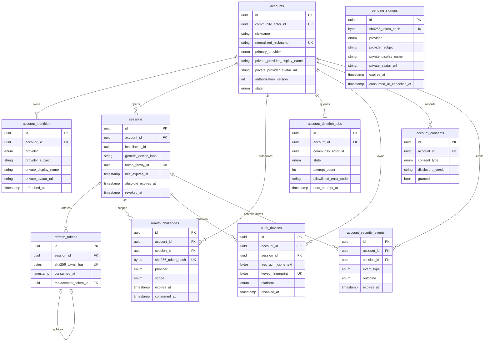

# Account Beta Private Schema

The authoritative definitions are Alembic migrations `0001` and `0002` plus
`account-server/app/db/models.py`. This diagram is a handoff view, not a second
schema source.

`pending_signups` intentionally has no account foreign key: a new identity does
not become an account or receive a normal session until nickname reservation
succeeds. The database stores only hashes of refresh, pending-signup, and
reauthentication tokens. FCM values are randomized AES-GCM ciphertext plus a
keyed deduplication fingerprint; no phone model or hardware ID is present.

The real account UUID and private provider profile never cross into community.
The random `community_actor_id` and current nickname are the only account-owned
authorship claims. Deletion jobs retain that actor only until community cleanup
is acknowledged, then the account relationship becomes null and only the
minimal non-personal outcome remains.

The community/training/telemetry stores are deliberately outside this diagram:

- community holds account actor/nickname for new signed writes and nullable
  read-only legacy pseudo identity for old rows;
- training uses random sample IDs and receipt hashes with no account, actor,
  installation, scan, IP, device, or community foreign key;
- telemetry uses only bounded technical dimensions and a coarse day, with no
  stable subject.
