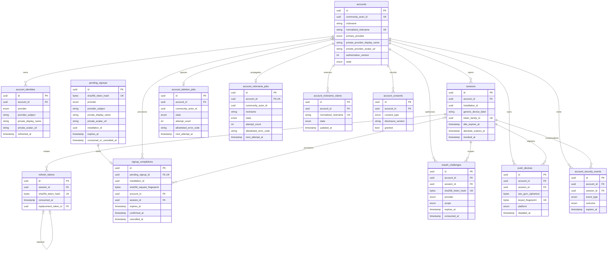

# Account Beta Private Schema

The authoritative definitions are Alembic migrations `0001` through `0006` plus
`account-server/app/db/models.py`. This diagram is a handoff view, not a second
schema source. The reviewed Alembic head is
`0006_signup_completion_idempotency`.

`pending_signups` intentionally has no account foreign key. Its installation
binding is established during provider exchange. Nickname completion creates a
provisional `signup_pending` account/session plus one bounded
`signup_completions` row. An exact retry with the same random completion ID,
installation ID, pending bearer, and normalized nickname recovers the same
derived credentials after a lost response; a mismatched retry fails closed.
Those provisional credentials cannot authorize normal account or community
operations until `/v1/auth/signup/confirm` atomically activates the account.
Cancellation or expiry removes the provisional account and its cascade-owned
private records, while a confirmed account remains active. Completion metadata
expires after the seven-day idempotency window.

The completion row stores a keyed request fingerprint, not a recoverable
pending or refresh bearer. The database otherwise stores only hashes of
refresh, pending-signup, and reauthentication tokens. FCM values are randomized
AES-GCM ciphertext plus a keyed deduplication fingerprint; no phone model or
hardware ID is present.

The real account UUID and private provider profile never cross into community.
The random `community_actor_id` and current nickname are the only account-owned
authorship claims. Deletion jobs retain that actor only until community cleanup
is acknowledged, then the account relationship becomes null and only the
minimal non-personal outcome remains.

The community/training/telemetry stores are deliberately outside this diagram:

- community holds account actor/nickname for new signed writes and nullable
  read-only legacy pseudo identity for old rows;
- training uses random sample IDs and receipt hashes with no account, actor,
  installation, scan, IP, device, or community foreign key;
- telemetry uses only bounded technical dimensions and a coarse day, with no
  stable subject.
